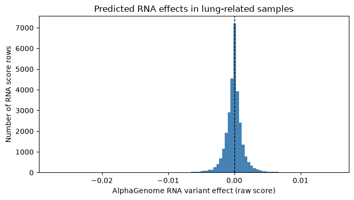
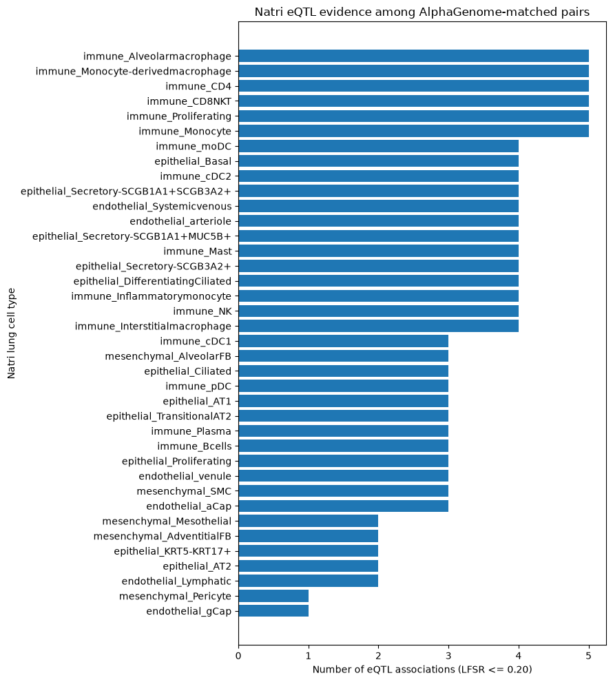

# alphagenome-eqtl-benchmarking
Predicting and evaluating regulatory effects of COPD-associated variants using AlphaGenome, Hi-C, and eQTL data.

## 1. Preparation of AlphaGenome Input Variants

### Selection of candidate Hi-C loops

Hi-C data from six human lung samples (3 healthy controls and 3 COPD) were processed using Juicer, followed by loop calling with HiCCUPS. The Juicer processing workflow is described in the [Lung Hi-C Analysis](https://github.com/divasan/Lung-HiC-Analysis) repository.

Loops were filtered to retain those with at least one anchor overlapping both ATAC-seq and enhancer peaks. We then selected loops connecting lung function-associated LD-expanded SNPs at one anchor to a gene transcription start site (TSS) at the other anchor.

This resulted in 189 candidate loops used for AlphaGenome input preparation.
**Input data:** [189 candidate Hi-C loops](data/189_clean_genes_final_candidate_loops.regulatory_direction_fixed.with_diffHiC_label_fuzzy30kb.bedpe)

### Step 1: Extract SNP–gene pairs

- Selected loops connecting SNP-containing enhancer anchors to gene TSSs.
- Retained 139 loops with 1,421 SNP–gene relationships, involving 711 unique SNPs and 201 genes.

### Step 2: Annotate reference and alternate alleles

- Obtained REF and ALT alleles from UCSC dbSNP155.
- Excluded chromosome annotation mismatches and retained SNVs.
- Split multiallelic SNPs into separate REF/ALT entries.
- Obtained 1,174 variant definitions from 710 SNPs. One SNP lacked a usable allele annotation.

### Step 3: Prepare AlphaGenome input files

Generated two files:

- `alphagenome_variant_input.clean.tsv` — Contains chromosome, position, REF, and ALT for AlphaGenome predictions.
- `alphagenome_SNP_loop_gene_input.tsv` — Contains 2,295 SNP–loop–gene rows linking variants to candidate target genes.

**Notebook:** [01_prepare_alphagenome_variants_commented.ipynb](notebooks/01_prepare_alphagenome_variants_commented.ipynb)

## 2. AlphaGenome RNA Variant Predictions

### Running AlphaGenome

We used AlphaGenome to predict how the 1,174 REF/ALT variants affect RNA expression.

Each variant was scored using the RNA-seq variant scorer with a 1 Mb window centered on the variant. We ran the predictions in batches of 25 and kept the scores for genes linked to the variants through Hi-C.

### Step 1: Run RNA predictions

- Ran all 1,174 variants in 47 batches.
- Found RNA scores for 1,103 variants and 179 target genes.
- Had 740,887 RNA score rows across all available biosamples.

### Step 2: Look at lung-related RNA scores

We kept scores from lung-related tissues and cells, including lung fibroblasts, alveolar epithelial cells, and lung endothelial cells.

This gave us 29,955 lung RNA score rows, covering 1,976 unique REF/ALT variant–gene pairs and 179 target genes.

### Step 3: Look at predicted RNA effects

Most predicted RNA effects were close to zero, with relatively few larger positive or negative scores.

To examine effects by gene, we selected the largest absolute RNA score for each gene across its linked variants and lung tracks.

The table below shows selected examples of genes with the largest absolute predicted RNA effects from the AlphaGenome rerun.

| Gene | SNP | Lung biosample | Raw score |
|---|---|---|---:|
| CARMIL2 | rs13334205 | Lung microvascular endothelial cell | -0.023065 |
| SERTAD2 | rs2302643 | Fibroblast of lung | -0.018789 |
| ZBTB16 | rs648116 | Lung microvascular endothelial cell | +0.016066 |
| PKD1 | rs3087631 | Fibroblast of lung | +0.015186 |
| RPS12P4 | rs3764906 | Upper lobe of left lung | -0.014387 |
| PHGR1 | rs8040086 | Upper lobe of left lung | +0.013117 |
| HMGN1P4 | rs504895 | Upper lobe of left lung | -0.012978 |
| TSPAN14 | rs7922621 | Left lung | +0.011761 |
| SCGB1A1 | rs2509967 | Left lung | +0.011102 |

Among these examples, CARMIL2 (−0.0231) and SERTAD2 (−0.0188) had the largest negative scores, while ZBTB16 (+0.0161) and PKD1 (+0.0152) had the largest positive scores.

**Notebook:** [02_alphagenome_variant_predictions_all_HPC.ipynb](notebooks/02_alphagenome_variant_predictions_all_HPC.ipynb)

## 3. Comparison with Lung Cell-Type-Specific eQTLs

### Matching AlphaGenome predictions with Natri eQTLs

We compared AlphaGenome-predicted RNA effects with lung cell-type-specific eQTL results from Natri et al.

The original eQTL data are available through [GEO accession GSE227136](https://www.ncbi.nlm.nih.gov/geo/query/acc.cgi?acc=GSE227136). We used a previously generated subset of these results containing eQTLs associated with the selected Hi-C loops.

### Step 1: Match SNP–gene pairs

- Matched AlphaGenome predictions with Natri eQTL results using chromosome, position, REF, ALT, and target gene.
- Identified 61 matching variant–gene pairs.
- Removed duplicate eQTL records and retained 2,318 variant–gene–cell-type observations across 38 lung cell types.

**Results:**
- [Hi-C-filtered Natri eQTL results](results/189_distal_loop_scEQTL_all_results.tsv)
- [61 matched variant–gene pairs](results/AlphaGenome_Natri_matched_variant_gene_pairs.tsv)

### Step 2: Select adult lung RNA predictions

We selected AlphaGenome's adult lung polyA+ RNA-seq track for comparison with Natri eQTL estimates.

One variant–gene pair involving SFTA3 had two different AlphaGenome RNA scores and was excluded.

This left 60 variant–gene pairs across 38 lung cell types, corresponding to 2,280 observations.

**Results:** [AlphaGenome–Natri adult lung comparison](results/AlphaGenome_Natri_adult_lung_comparison.tsv)

### Step 3: Identify eQTL-supported pairs

Among the 60 matched variant–gene pairs:

- 5 had a local false sign rate (LFSR) ≤ 0.20 in at least one cell type, representing 130 observations.
- 1 had LFSR ≤ 0.05 in at least one cell type, representing 28 observations.

The LFSR ≤ 0.20 threshold was used for exploratory analysis.

### Step 4: Compare predicted RNA effects with eQTL estimates

The table below shows the five variant–gene pairs with LFSR ≤ 0.20 in at least one cell type.

| Gene | Variant (REF→ALT) | AlphaGenome score | Mean Natri beta | Minimum LFSR |
|---|---|---:|---:|---:|
| SFTPA2 | chr10:79946568 A→G | -0.000154 | -0.055769 | 0.009796 |
| CSRP1 | chr1:201445972 C→T | -0.000404 | +0.036405 | 0.100294 |
| TRABD | chr22:49935414 T→C | +0.000623 | -0.054573 | 0.106468 |
| AP3D1 | chr19:2232050 G→A | +0.000152 | +0.048459 | 0.126989 |
| TRABD | chr22:49949496 T→C | +0.000046 | -0.058782 | 0.185176 |

Mean Natri beta was calculated across cell types with LFSR ≤ 0.20 for each variant–gene pair.

Two pairs (SFTPA2 and AP3D1) had matching reported effect signs, while three (CSRP1 and the two TRABD variants) had opposite signs.

However, the effect-allele orientation of Natri's posterior estimates has not yet been verified. Therefore, these comparisons do not establish confirmed directional agreement or disagreement between AlphaGenome and the eQTL estimates.

Overall, this pilot comparison identified five Hi-C-linked variant–gene pairs with eQTL support at the exploratory LFSR threshold. Further analysis is needed before assessing AlphaGenome's directional prediction accuracy.

**Notebook:** [03_alphagenome_natri_eqtl_pilot.ipynb](notebooks/03_alphagenome_natri_eqtl_pilot.ipynb)
